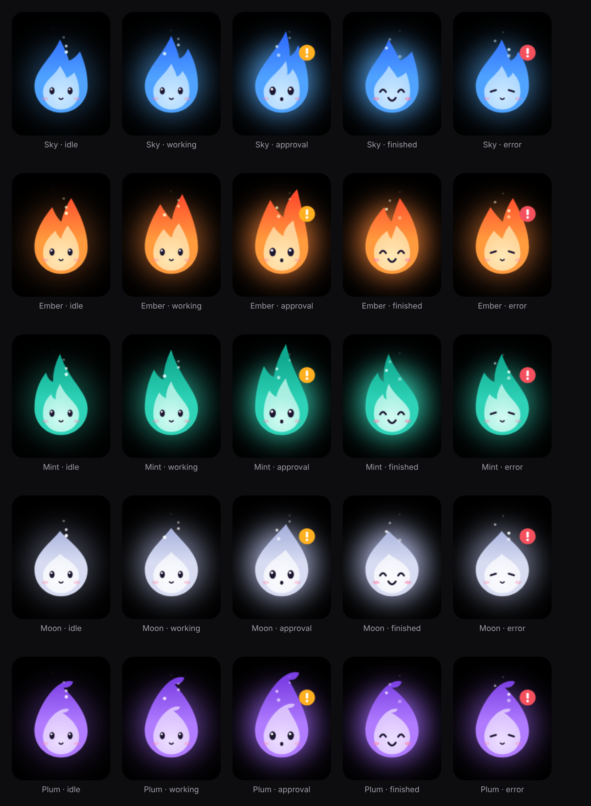

<div align="center">


# Notchling

**A little flame in your MacBook notch that watches the Claude desktop app.**
It shows what Claude is doing while it answers. When Claude asks for permission, the flame pops out of the notch, and you can approve without switching to the window.

**English** · [Русский](README.ru.md)



</div>

---

## What it does

- 🔥 **Live status.** While Claude is answering, the current step shows up next to the notch: “Thinking…”, “Searching the web”, “Running a command”…
- ✅ **Approvals from the notch.** When Claude asks for access (a folder, files, an app), the flame pops out with a sound and shows exactly what is being requested. **Allow / This session / Decline** press the real button in Claude's window. Before pressing it, Notchling checks that the same request is still on screen.
- 💬 **Approval in another chat.** If a chat that isn't open right now is waiting for approval, the flame tells you and opens that chat.
- 🎉 **Done!** When the answer is finished, the flame does a flip, throws sparks and shows the start of the reply.
- 📄 **Which file is being read.** For local MCP servers you see the exact tool name and file path (read from Claude's local logs).
- 🎨 **Five flames:** Sky, Ember, Mint, Moon and Plum. Their eyes follow your cursor; poke one five times and it gets dizzy.
- 🔊 **Original sounds.** Generated in code (`tools/make_sounds.py`): little bells, bubbles, a crackle of fire.
- 🌍 **English and Russian.** Chosen on first launch, switchable any time in the 🔥 menu → Language.

## Privacy

**Notchling never touches the network. At all.**

- There isn't a single networking call in the code; the app doesn't even link macOS networking frameworks (Network, CFNetwork). `build.sh` checks this on every build and stops if a networking call ever appears.
- No telemetry, analytics, auto-updates or accounts.
- Notchling only **reads** Claude's window through the Accessibility API and the local logs `~/Library/Logs/Claude/mcp*.log`. Chat text is never stored anywhere.
- The only thing it ever presses is the approval button, and only after you click it in the notch.

Check it yourself: `nm -u ~/Applications/Notchling.app/Contents/MacOS/Notchling | grep -i -E "URLSession|socket|connect"` prints nothing. Or run LuLu / Little Snitch.

## Install

You need macOS 14+ and the Command Line Tools (no Xcode required):

```bash
xcode-select --install          # if you don't have them yet
git clone https://github.com/aevlanov/notchling.git
cd notchling
bash build.sh
```

`build.sh` builds the app, checks it has no networking, signs it with a local certificate “Notchling Local Signing” and installs it to `~/Applications/Notchling.app`. The certificate is created once, only in your login keychain; macOS may ask to allow `codesign` the first time.

Then enable Notchling in **System Settings → Privacy & Security → Accessibility** and relaunch it. This is needed to read Claude's window.

## The 🔥 menu

- **Flame**: pick your character.
- **Language**: English / Русский.
- **Hide when idle**: by default the flame always sits by the notch.
- **Sound**.
- **Save diagnostics**: a summary of what Notchling sees in the window (no message text) in `~/Library/Logs/Notchling/diag.txt`.

## How it works

The Claude app has no event API for regular chat. So every 0.7 s Notchling reads the Accessibility tree of Claude's window (Electron exposes it after the `AXManualAccessibility` flag) and looks for:

| What it looks for | What it means |
|---|---|
| `Stop response` button | Claude is answering |
| `AXApplicationStatus` = `Running` / `Awaiting input` on a chat in the sidebar | the chat is working / waiting for approval, even when it isn't open |
| `<step> running` button inside `Currently streaming message` | the current step |
| `Permission request…` group | the approval card: title, fields, buttons |
| `Claude responded: …` | the start of the latest reply |

**Limitations.** This is UI recognition, not an official API. If Anthropic changes the labels in the app, the watcher will need a fix; `tools/ax-dump.swift` is there for that.

## Development

```
Sources/Wisp/WispEngine.swift      the flame: shape, eyes, animations, particles
Sources/App/ClaudeWatcher.swift    Claude window watcher, button presses
Sources/App/MCPLogTail.swift       reading local MCP server logs
Sources/App/IslandView.swift       the notch UI (SwiftUI)
Sources/App/IslandWindowController.swift   transparent panel over the notch
Sources/App/L10n.swift             English / Russian strings
tools/ax-dump.swift                snapshots of Claude's Accessibility tree
tools/make_sounds.py               sound generator (numpy)
tools/preview/wisp.html            flame preview in a browser
dev.sh                             rebuilds when a .rebuild trigger file appears
```

Create a `.devmode` file in the project folder and `build.sh` will turn on a detailed log in `.diag/`.

## Credits

Inspired by [coucou](https://github.com/Louis-CFM/coucou) by Louis Raillé. A few small pieces of its MIT-licensed code are adapted here, see [THIRD_PARTY_NOTICES.md](THIRD_PARTY_NOTICES.md). Notchling's character, icon and sounds are original; coucou's name, character and sounds are not used.

Notchling is not affiliated with Anthropic. Claude is a trademark of Anthropic.

License: [MIT](LICENSE).
